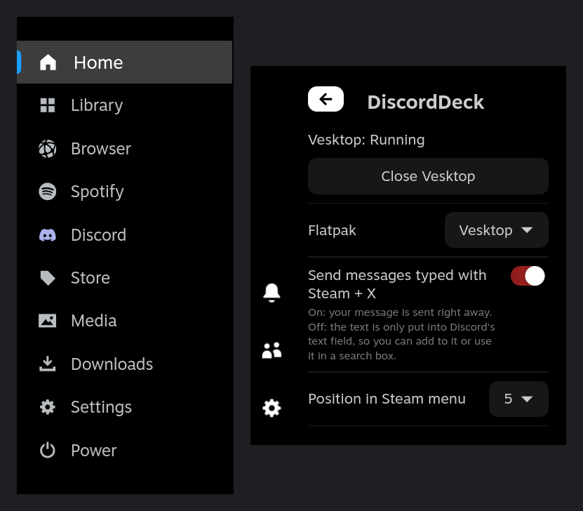

# DiscordDeck

Adds **Discord** to the Steam menu in Gaming Mode. It opens the official Discord flatpak (`com.discordapp.Discord`) or [Vesktop](https://github.com/Vencord/Vesktop) (Discord with Vencord, `dev.vencord.Vesktop`), installed from Discover in Desktop Mode, without adding it to your library as a non-Steam game.

- Pick **Discord** in the Steam menu to open it. It starts the app first if it isn't running yet.
- Press the Steam button and pick anything else to go back to Steam. Discord keeps running in the background, so you stay in voice chat.
- Press Steam + X while Discord is open to type a message with Steam's keyboard. Press Enter or Send and it's typed into the text field selected in Discord, usually the message box of the open channel.
- Highlight Discord in the Steam menu and press X to close it, or use the Close button in the Quick Access menu.
- The Quick Access menu also sets where Discord sits in the Steam menu, whether messages typed with Steam + X are sent right away or only put into the text field, and which flatpak to open: Discord or Vesktop.

## Installation

You need:

- [Decky Loader](https://decky.xyz) 3 or newer
- Discord (Flathub `com.discordapp.Discord`) or Vesktop (Flathub `dev.vencord.Vesktop`)

1. If you don't have Decky Loader yet, switch to Desktop Mode, download the installer from [decky.xyz](https://decky.xyz) and run it.
2. In Desktop Mode, open Discover, search for Discord or Vesktop and install it.
3. Still in Desktop Mode, open Discord or Vesktop and log in to your account. Logging in is easier with a mouse and keyboard here than in Gaming Mode, and the plugin opens the app already logged in.
4. Maximize the app's window before you close it. The app remembers its window size, and a maximized window fills the screen properly in Gaming Mode.
5. Download `DiscordDeck.zip` from the [latest release](https://github.com/Lexodeus/DiscordDeck/releases/latest), then switch back to Gaming Mode.
6. Open the Quick Access menu, go to Decky and select the gear icon. Under **General**, turn on **Developer mode**.
7. Open the **Developer** tab that appears, select **Install Plugin from ZIP File** and pick `DiscordDeck.zip`.

## Getting around in Discord

Discord is a desktop app and doesn't support the controller's buttons, so you use a mouse pointer to move around in it:

- **Controller:** hold the Steam button and move your thumb on the right trackpad to move the pointer. Keep holding Steam and press R2 to click (L2 to right-click).
- **Mouse:** plug in a USB mouse or pair a Bluetooth mouse, and use it like on a desktop.
- **Typing:** select a text field with the pointer, such as a channel's message box, then press Steam + X (see above). A USB or Bluetooth keyboard also types straight into Discord.

## How it works

Gaming Mode's compositor (gamescope) only shows windows that belong to an app Steam launched. The plugin's backend starts Discord in your user session and tags its window with a placeholder app ID. While Steam is on the plugin's Discord page, the backend asks gamescope to show that window. When Steam navigates away, or brings a game to the front, it hands the screen back to Steam.

Steam's on-screen keyboard only types into Steam's own UI, so the plugin shows a message box on Steam's page instead and types the text into Discord with `xdotool`.

## Privacy

DiscordDeck is only a container for the Discord app. It starts Discord or Vesktop and shows its window in Gaming Mode; you log in and chat in the app itself, and DiscordDeck never sees your account or password. DiscordDeck doesn't store or send your data or credentials anywhere, and it makes no network connections of its own. The only things it saves are its own settings (which app to open, Discord's position in the Steam menu, and whether Steam + X messages are sent right away), on your device. Text you type with Steam + X is typed straight into Discord and isn't saved or logged.

## Credits

The Steam menu patch is adapted from [DeckWebBrowser](https://github.com/jessebofill/DeckWebBrowser) by Jesse Bofill (GPL-3.0).

## License

GPL-3.0
